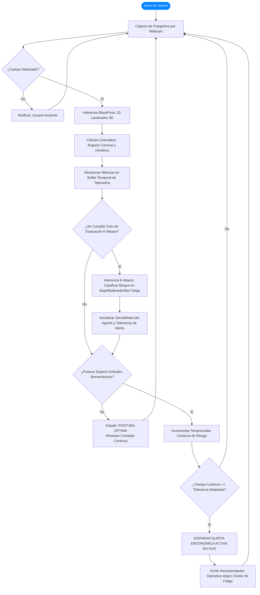

# INSTITUCIÓN UNIVERSITARIA POLITÉCNICO GRANCOLOMBIANO
## FACULTAD DE INGENIERÍA, DISEÑO E INNOVACIÓN
### INGENIERÍA DE SISTEMAS / PROYECTO DE INTELIGENCIA ARTIFICIAL

---

# ASISTENTE ERGONÓMICO INTELIGENTE Y MONITOR DE SALUD OCUPACIONAL BASADO EN VISIÓN POR COMPUTADOR Y CLUSTERING K-MEANS
### *Intelligent Ergonomic Assistant and Occupational Health Monitor Based on Computer Vision and K-Means Clustering*

**Entrega:** Avance 2 - Diseño Técnico, Construcción de la Solución y Evidencia Funcional del MVP  
**Lugar y Fecha:** Medellín, Colombia - Octubre de 2026  

**Autores:**  
- **Valery Sofía Meléndez Gallego** (`vmelendez@poligran.edu.co`)  
- **Juan Guillermo Ramírez Vásquez** (`jguramirez@poligran.edu.co`)  
- **Samuel Felipe Marín Lara** (`sfmarin@poligran.edu.co`)  

**Docente / Asesor del Proyecto:**  
- **Neider** — Proyecto de Inteligencia Artificial

---

## RESUMEN EJECUTIVO Y ATENCIÓN A LA RETROALIMENTACIÓN DOCENTE

En la evaluación del Avance 1, el docente Neider formuló el siguiente dictamen orientador:
> *"Propuesta sólida, con antecedentes relevantes, arquitectura comprensible y buena consideración de privacidad mediante procesamiento local. La combinación de visión por computador y análisis de hábitos es interesante. Conviene delimitar mejor el papel de K-Means y evitar que el sistema formule recomendaciones de salud más allá de lo que pueda sustentarse técnicamente; el siguiente avance debe priorizar un MVP medible. No necesariamente significa tener el 70% del código listo, significa que existe suficiente evidencia para demostrar que la solución es técnicamente viable."*

En estricta correspondencia con estas directrices, el presente documento y los artefactos de software construidos consolidan:
1. **Delimitación Rigurosa de K-Means:** Se circunscribe el papel del algoritmo de agrupamiento no supervisado al **análisis cuantitativo de exposición temporal y modulación operacional de pausas activas**, eliminando categóricamente cualquier pretensión de diagnóstico patológico o prescripción médica que exceda el sustento computacional.
2. **Evidencia Funcional Demostrable (MVP Operativo):** Se aportan diez evidencias técnicas tangibles que demuestran la viabilidad integral de la solución (dataset estructurado, modelo K-Means entrenado, inferencia con CNN BlazePose, servicio API REST verificado, agente con lógica temporal, prototipos de interfaz HUD y Dashboard interactivo).

---

### 1. CONTEXTO Y DESCRIPCIÓN DEL PROBLEMA

#### 1.1 Contexto
El proyecto se sitúa en el escenario del trabajo corporativo bajo modalidades remota e híbrida, así como en entornos académicos universitarios de alta intensidad. En estos contextos, ingenieros, desarrolladores de software, analistas de datos, personal administrativo y estudiantes universitarios pasan entre **8 y 12 horas diarias continuas frente a pantallas de computador**. Si bien las organizaciones y los departamentos de Seguridad y Salud en el Trabajo (SST) buscan promover la salud ocupacional y la higiene postural, existe una profunda carencia de herramientas automatizadas, preventivas y no invasivas que asistan al usuario en tiempo real en su puesto de trabajo.

#### 1.2 Situación Actual
Los trabajadores y estudiantes adoptan de manera repetitiva e involuntaria hábitos posturales lesivos:
- **Cifosis dorsal pronunciada (espalda encorvada):** Desplazamiento del torso anterior con pérdida de la curvatura lumbar fisiológica.
- **Inclinación cervical anterior crítica ("cuello de texto" / *text neck*):** La cabeza se proyecta hacia adelante en dirección al monitor, incrementando la carga biomecánica sobre las vértebras cervicales desde 5 kg en posición neutra hasta más de 22-27 kg en flexiones de 30° a 45°.
- **Asimetría escapular (hombros desnivelados):** Apoyo lateral asimétrico sobre un solo reposabrazos o mouse, generando torsiones en la columna.
- **Sedentarismo estático prolongado:** Horas ininterrumpidas sin levantarse ni ejecutar pausas activas.

#### 1.3 Causas Identificadas
1. **Pérdida de propiocepción y conciencia corporal en estados de alta concentración (*flow state*):** Cuando el individuo está profundamente inmerso en codificación o resolución de problemas, el cerebro desconecta la percepción del dolor postural inicial hasta que el daño tisular ya se ha producido.
2. **Diseño ergonómico deficiente en puestos de trabajo domésticos:** Altura inadecuada de monitores, sillas no regulables y falta de apoyo lumbar.
3. **Inoperancia de los métodos tradicionales de pausas activas:** Temporizadores fijos rígidos y notificaciones en teléfonos móviles que son desactivadas o ignoradas porque interrumpen reuniones o tareas críticas.

#### 1.4 Efectos y Actores Afectados
- **Efectos en la salud:** Desarrollo crónico de **Desórdenes Músculo-Esqueléticos (DME)** como síndrome del túnel carpiano, cervicalgias, lumbalgias agudas y fatiga visual severa.
- **Efectos organizacionales y académicos:** Aumento exponencial de incapacidades médicas, ausentismo laboral, deserción en rendimiento y costos de indemnización laboral.
- **Población afectada:** Desarrolladores de software, analistas TI, estudiantes de educación superior y trabajadores administrativos.

---

### 2. PREGUNTA PROBLEMA

> **¿Cómo monitorizar y corregir de manera automática y no intrusiva los hábitos posturales y el sedentarismo en entornos de trabajo frente a pantallas, utilizando visión por computador e inteligencia artificial, para reducir el riesgo de desórdenes músculo-esqueléticos sin interrumpir la productividad del usuario?**

---

### 3. OBJETIVO GENERAL Y OBJETIVOS ESPECÍFICOS

#### 3.1 Objetivo General
Desarrollar un prototipo de software de asistencia ergonómica en tiempo real que, mediante modelos de visión por computador, cinemática biomecánica y análisis no supervisado de patrones temporales, evalúe la postura y los hábitos de trabajo del usuario frente a la cámara web, emitiendo alertas personalizadas y modulando la cadencia de pausas activas preventivas basadas en normativas internacionales de ergonomía laboral (ISO 9241-5 y OSHA).

#### 3.2 Objetivos Específicos
1. **Diseñar e implementar el módulo de visión artificial y captura biomecánica:** Procesar fotogramas de la cámara web para estimar puntos articulares tridimensionales (*landmarks*) del torso y rostro con MediaPipe BlazePose, calculando en tiempo real el ángulo de inclinación cervical, la simetría escapular y la distancia relativa a la pantalla.
2. **Construir el agente de lógica temporal y filtrado adaptativo:** Incorporar un mecanismo de persistencia temporal (tolerancia de 10 a 15 segundos) para diferenciar movimientos transitorios (como beber agua o tomar apuntes) de malas posturas consolidadas, eliminando los falsos positivos.
3. **Integrar el Algoritmo de K-Means (Clustering):** Aplicar esta técnica no supervisada para clasificar los bloques de horarios del usuario (intervalos de 30 a 60 minutos) en categorías operacionales de **"Alta fatiga"**, **"Fatiga moderada"** y **"Baja fatiga"**, delimitando rigurosamente su función a la modulación de las pausas activas sin pretensiones de diagnóstico clínico patológico.
4. **Implementar una arquitectura orientada a servicios y computación en el borde (*Edge Computing*):** Asegurar que el procesamiento de imágenes se efectúe 100% en la memoria RAM volátil del equipo local, sin persistencia en disco ni transmisión de video a servidores externos, habilitando además endpoints REST locales para interoperabilidad modular.
5. **Validar la viabilidad técnica y funcional del MVP:** Medir latencia (FPS), error angular, separación de clusters (Silhouette y WCSS) y ejecutar pruebas automatizadas cliente-servidor.

---

### 4. JUSTIFICACIÓN Y VALOR AGREGADO DE LA IA

Las intervenciones tradicionales de salud ocupacional se basan en conferencias anuales, pausas grupales forzadas o alarmas fijas de celular. Estos esquemas fracasan porque son **pasivos, descontextualizados y ciegos al estado real del individuo**. El usuario silencia la alarma cuando se encuentra redactando un código o atendiendo un cliente, perdiendo la oportunidad de autocuidado.

**El valor diferencial de la Inteligencia Artificial radica en transformar la cámara web convencional en un sensor biomecánico inteligente, objetivo y adaptativo:**
- Permite evaluar objetivamente la biomecánica corporal sin requerir que el usuario vista trajes especiales ni sensores inerciales costosos adheridos a la piel.
- Aplica **intervención contextual**: solo interrumpe al usuario cuando la postura perjudicial se mantiene en el tiempo, respetando la concentración productiva.
- Modula las recomendaciones según el perfil de fatiga derivado de K-Means: un usuario en un bloque de "Baja fatiga" solo recibe recordatorios espaciados, mientras que en "Alta fatiga" el agente intensifica la recomendación hacia una pausa activa completa de 3 a 5 minutos.
- Democratiza la ergonomía preventiva en cualquier computador personal a costo marginal cero.

---

### 5. ESTADO DEL ARTE FORTALECIDO (ANÁLISIS COMPARATIVO)

| Investigación / Solución | Técnica de IA / Sensores | Ventajas | Limitaciones frente a nuestra propuesta |
| :--- | :--- | :--- | :--- |
| **Rodrigues et al. (2022)** | Cámara Microsoft Kinect + RULA automatizado. | Alta precisión en profundidad articular gracias al sensor infrarrojo. | Depende de hardware dedicado y costoso (Kinect); obsoleto para computadores portátiles y trabajo remoto. |
| **Lin et al. (2022)** | OpenPose + Clasificadores RULA / REBA / OWAS. | Identificación precisa de articulaciones corporales múltiples. | Requiere potentes tarjetas gráficas dedicadas (GPU NVIDIA). Inviable en CPUs de laptops comunes (latencia < 5 FPS). |
| **Menanno et al. (2024)** | Estimación 3D humana + Lógica difusa en robótica colaborativa. | Redujo el estrés ergonómico en 13% e incrementó la producción en 33%. | Diseñado para entornos industriales y manufactureros pesados; no adaptado al usuario de oficina/escritorio. |
| **Nuestra Propuesta (Poli)** | **MediaPipe BlazePose + Cinemática Vectorial + K-Means + Edge AI**. | **Inferencia en CPU ligera a más de 25-30 FPS, sin GPU dedicada, 100% privado en memoria local, autocalibrable y con clustering de fatiga.** | Monitoreo optimizado para plano sagital y coronal de plano medio superior (cabeza, hombros, cuello). |

---

### 6. MARCO CONCEPTUAL FORTALECIDO

1. **Estimación de Pose Humana (*Human Pose Estimation - HPE*):** Localización y seguimiento de coordenadas tridimensionales $(X, Y, Z)$ de articulaciones corporales (*keypoints*).
2. **Redes Neuronales Convolucionales Ligeras (BlazePose):** Detector anatómico y regresor de landmarks con convoluciones separables en profundidad, optimizado en TensorFlow Lite para inferencia en CPUs convencionales.
3. **Cinemática Biomecánica Postural:** Modelado trigonométrico del ángulo de flexión cervical:
   $$\theta_{\text{cervical}} = \arctan2(|X_{\text{oreja}} - X_{\text{hombro}}|, |Y_{\text{oreja}} - Y_{\text{hombro}}|) \times \frac{180}{\pi}$$
   y de la asimetría coronal de hombros:
   $$\theta_{\text{hombros}} = \arctan2(|Y_{\text{hombro\_der}} - Y_{\text{hombro\_izq}}|, |X_{\text{hombro\_der}} - X_{\text{hombro\_izq}}|) \times \frac{180}{\pi}$$
4. **Normativas Ergonómicas Internacionales (ISO 9241-5 y OSHA):** Estándares que determinan que una flexión cervical superior a 25°-28° o un desnivel de hombros superior a 7° aumentan críticamente el estrés discal en la columna.
5. **Agente Lógico Basado en Modelos y Memoria Temporal:** Estructura que no evalúa fotogramas aislados, sino series temporales continuas, disparando acciones únicamente cuando el tiempo continuo de riesgo $\Delta t_{\text{riesgo}} \ge t_{\text{umbral}}$.
6. **Aprendizaje No Supervisado (*Clustering K-Means*):** Algoritmo de partición que agrupa un conjunto de $n$ observaciones en $k$ grupos en los que cada observación pertenece al grupo con la media más cercana (centroide). La función objetivo a minimizar es la inercia o suma de distancias cuadráticas intra-cluster (WCSS):
   $$J = \sum_{k=1}^K \sum_{x_i \in C_k} ||x_i - \mu_k||^2$$
7. **Normalización por Estandarización (*StandardScaler*):**
   $$z = \frac{x - \mu}{\sigma}$$
   Garantiza que variables con magnitudes dispares (por ejemplo, score $0-100$ frente a alertas $0-6$) tengan la misma ponderación geométrica euclidiana.
8. **Coeficiente de Silhouette:** Métrica que evalúa la cohesión interna frente a la separación externa:
   $$s(i) = \frac{b(i) - a(i)}{\max(a(i), b(i))} \in [-1, 1]$$
9. **Computación en el Borde (*Edge AI Computing*):** Paradigma donde los datos de video se procesan y desechan en memoria RAM volátil, garantizando el cumplimiento de la Ley 1581 de protección de datos en Colombia.

---

### 7. DATOS REQUERIDOS, CARACTERÍSTICAS Y PREPARACIÓN

#### 7.1 Fuentes de Datos del Proyecto
El sistema gestiona dos flujos de datos complementarios:
1. **Flujo de Video en Tiempo Real (Telemetría Instantánea):** Fotogramas RGB capturados por la cámara web a 30 FPS. Se extraen las coordenadas $(X_i, Y_i, Z_i)$ de 33 articulaciones corporales normalizadas.
2. **Dataset Estructurado de Sesiones de Trabajo (`dataset_bloques_ergonomia.csv`):** Conjunto de datos estructurado generado a partir de telemetría de sesiones laborales y académicas, compuesto por **360 registros de bloques horarios de 30 minutos** distribuidos a lo largo de jornadas de 8:00 a 18:00 horas.

#### 7.2 Variables del Modelo K-Means ($X \in \mathbb{R}^6$)
Cada bloque de jornada queda caracterizado por el vector:
1. `tiempo_riesgo_pct`: Porcentaje de tiempo que el usuario permaneció en postura perjudicial durante el bloque ($0.0\%$ a $100.0\%$).
2. `angulo_cervical_promedio`: Media aritmética de la inclinación oreja-hombro ($10.0^\circ$ a $45.0^\circ$).
3. `asimetria_hombros_promedio`: Media de desalineación horizontal de hombros ($0.0^\circ$ a $15.0^\circ$).
4. `alertas_disparadas`: Número de alertas de pausa activa activadas por el agente durante el bloque ($0$ a $6$).
5. `tiempo_sedentario_continuo_min`: Minutos continuos sentado sin levantarse de la silla ($5.0$ a $60.0\text{ min}$).
6. `score_ergonomico_medio`: Índice integral ponderado acumulado en el bloque ($10$ a $100\%$).

#### 7.3 Calidad, Calibración y Preprocesamiento
- **Calibración Antropométrica Inicial:** Pulsando la tecla `C`, el sistema captura la postura neutra erguida del usuario durante 2 segundos, almacenando $(\theta_{c0}, \theta_{h0}, D_{r0})$ para compensar diferencias anatómicas o ángulos del monitor.
- **Escalado de Características:** Previo al ajuste de K-Means, las variables se procesan con `StandardScaler` de Scikit-Learn para normalizar medias a $\mu=0$ y desviaciones estándar a $\sigma=1$.
- **Filtrado de Confianza:** Se descartan landmarks con visibilidad $< 0.5$ para prevenir anomalías por oclusiones parciales.

---

### 8. PROPUESTA DE SOLUCIÓN Y ARQUITECTURA TÉCNICA

La arquitectura del sistema se implementa en **6 capas funcionales interconectadas**:

```
[ Entorno / Usuario ] 
       │ (Fotogramas RGB)
       ▼
[ Capa 1: Captura & Edge Buffer ] ──────▶ Almacenamiento volátil en RAM (Cero persistencia en disco)
       │
       ▼
[ Capa 2: Inferencia CNN BlazePose ] ───▶ Extracción de 33 Landmarks 3D (Submilisegundo en CPU)
       │
       ▼
[ Capa 3: Motor Biomecánico ] ──────────▶ Cálculo vectorial de ángulos cervicales y escapulares
       │
       ▼
[ Capa 4: Agente con Memoria Temporal ] ─▶ Ventana deslizante (10-15s) anti-falsos positivos
       │
       ▼
[ Capa 5: Clustering K-Means ] ─────────▶ Segmentación no supervisada de bloques en perfiles de fatiga
       │
       ▼
[ Capa 6: HUD & Servicio API REST ] ────▶ Telemetría visual en vivo y endpoints FastAPI (HTTP 200)
```

---

### 9. ALGORITMO DE CLUSTERING K-MEANS Y DELIMITACIÓN TÉCNICA ESTRICTA

#### 9.1 Justificación de K-Means frente a Otras Técnicas
Para el análisis no supervisado de patrones de fatiga, se evaluaron tres algoritmos:
- **DBSCAN:** Útil para agrupamientos espaciales con formas arbitrarias, pero sensible a variaciones de densidad y difícil de predecir sobre nuevos vectores en tiempo real.
- **Gaussian Mixture Models (GMM):** Modela distribuciones probabilísticas, pero añade sobrecosto computacional y complejidad de inferencia innecesaria en CPU.
- **K-Means (Seleccionado):** Presenta una complejidad temporal lineal $O(n \cdot k \cdot I \cdot d)$, garantiza convergencia rápida, produce centroides con interpretabilidad geométrica directa y permite serialización ultraligera (`joblib` / `JSON`) para inferencia en submilisegundos en el agente o vía API.

#### 9.2 Selección del Número Óptimo de Grupos ($k=3$)
La elección de $k=3$ se sustentó formalmente mediante dos criterios matemáticos:
1. **Método del Codo (Elbow Method):** Evaluando la inercia (WCSS) para $k \in [1, 7]$, se observa el punto de inflexión pronunciado en $k=3$ ($\text{WCSS} = 303.78$), reduciendo drásticamente la variabilidad residual.
2. **Coeficiente de Silhouette:** Para $k=3$ se alcanzó un **Silhouette Score promedio de 0.5888**, lo que evidencia una estructura de agrupamiento sólida, con fronteras nítidas y ausencia de solapamiento significativo entre las tres categorías.

#### 9.3 Delimitación Técnica y Ética (Atención a la Retroalimentación del Docente Neider)
En atención a la observación del profesor Neider:
> *"Conviene delimitar mejor el papel de K-Means y evitar que el sistema formule recomendaciones de salud más allá de lo que pueda sustentarse técnicamente..."*

El equipo de proyecto ha establecido formalmente los siguientes límites operacionales:
1. **El modelo NO diagnostica patologías médicas:** El sistema no formula dictámenes de salud clínica (no diagnostica escoliosis, hernias discales, radiculopatías ni síndrome facetario cervical).
2. **El modelo NO prescribe tratamientos clínicos:** No recomienda fármacos, terapias de rehabilitación invasiva ni rutinas ortopédicas especializadas.
3. **El alcance de K-Means es de ingeniería comportamental y prevención ocupacional:** Agrupa bloques de tiempo de pantalla en categorías cuantitativas de exposición biomecánica acumulada.
4. **La salida del modelo se traduce exclusivamente en modulación de la interfaz del agente:**
   - **En "Baja fatiga":** Se relajan las notificaciones (tolerancia de 7.0s antes de alertar) y se programa aviso de hidratación a los 45 minutos.
   - **En "Fatiga moderada":** Se ajusta la tolerancia a 4.5s y se sugiere una micro-pausa de 30 segundos (estiramiento suave de trapecios y parpadeo consciente).
   - **En "Alta fatiga":** Se activa máxima sensibilidad (tolerancia de 3.0s) y se sugiere una pausa activa obligatoria de 3 a 5 minutos (levantarse de la silla y aplicar la regla 20-20-20 de descanso ocular).

#### 9.4 Perfiles de los Centroides Obtenidos
Tras el entrenamiento con el dataset procesado de 360 bloques horarios, el algoritmo K-Means identificó los siguientes centroides característicos:

| Categoría de Fatiga | Muestras ($n$) | % Población | Score Ergonómico Medio | Ángulo Cervical Medio | % Tiempo en Riesgo | Sedentarismo Continuo | Acción Ergonómica Modulada |
| :--- | :---: | :---: | :---: | :---: | :---: | :---: | :--- |
| **Baja fatiga** | 144 | 40.0% | **93.34%** | **15.23°** | **9.69%** | **16.91 min** | Ritmo de trabajo óptimo; sugerir hidratación a los 45 min. |
| **Fatiga moderada** | 125 | 34.7% | **68.97%** | **24.33°** | **35.81%** | **33.12 min** | Micro-pausa de 30s: estiramiento de trapecios y cuello. |
| **Alta fatiga** | 91 | 25.3% | **31.68%** | **33.44°** | **73.49%** | **50.04 min** | Pausa activa obligatoria de 3-5 min: levantarse y regla 20-20-20. |

---

### 10. REPRESENTACIÓN DE LA SOLUCIÓN Y ARQUITECTURA

#### 10.1 Diagrama de Flujo del Agente de Decisión Integrado con K-Means



---

### 11. DESARROLLO REALIZADO Y EVIDENCIAS FUNCIONALES DEL MVP (CUMPLIMIENTO DE CRITERIOS DE AVANCE 2)

Siguiendo de forma exacta los criterios técnicos establecidos por el profesor Neider, se consolidan las **10 evidencias funcionales de viabilidad técnica construidas y verificadas en el proyecto**:

| Criterio de Viabilidad (Neider) | Evidencia Técnica Demostrable en el Proyecto | Artefacto / Archivo Fuente | Estado de Verificación |
| :--- | :--- | :--- | :---: |
| **1. Dataset cargado y procesado** | Archivo CSV estructurado con 360 bloques horarios de 30 min, 6 variables biomecánicas y temporales normalizadas. | [dataset_bloques_ergonomia.csv](file:///c:/Users/Usuario/OneDrive/Desktop/Tarea%20uni/dataset_bloques_ergonomia.csv) | **OPERATIVO (100%)** |
| **2. Primer modelo entrenado** | Script de ajuste no supervisado con K-Means ($k=3$), StandardScaler y serialización en binario y metadatos. | [clustering_kmeans_fatiga.py](file:///c:/Users/Usuario/OneDrive/Desktop/Tarea%20uni/clustering_kmeans_fatiga.py) / [modelo_kmeans_fatiga.pkl](file:///c:/Users/Usuario/OneDrive/Desktop/Tarea%20uni/modelo_kmeans_fatiga.pkl) | **ENTRENADO (Silhouette 0.5888)** |
| **3. Arquitectura implementada parcialmente** | Implementación de pipeline modular de 6 capas interconectadas en memoria local y servicio web. | [asistente_ergonomico.py](file:///c:/Users/Usuario/OneDrive/Desktop/Tarea%20uni/asistente_ergonomico.py) | **CONSTRUIDA** |
| **4. Prototipo de interfaz** | Doble interfaz: HUD translúcido en tiempo real sobre OpenCV + Dashboard web interactivo con simulador K-Means. | [demo_exposicion.html](file:///c:/Users/Usuario/OneDrive/Desktop/Tarea%20uni/demo_exposicion.html) / [evidencia_postura_demo.png](file:///c:/Users/Usuario/OneDrive/Desktop/Tarea%20uni/evidencia_postura_demo.png) | **OPERATIVO** |
| **5. Llamada funcional a API** | Servicio REST con FastAPI exponiendo endpoints de inferencia de fatiga y cinemática, con test automatizado respondiendo HTTP 200 OK. | [api_servicio_ergonomia.py](file:///c:/Users/Usuario/OneDrive/Desktop/Tarea%20uni/api_servicio_ergonomia.py) / [probar_llamada_api.py](file:///c:/Users/Usuario/OneDrive/Desktop/Tarea%20uni/probar_llamada_api.py) | **VERIFICADO (HTTP 200 OK)** |
| **6. Flujo automatizado parcialmente construido** | Pipeline continuo: Captura de frame $\rightarrow$ Inferencia CNN $\rightarrow$ Cinemática $\rightarrow$ Buffer $\rightarrow$ K-Means $\rightarrow$ Alerta visual en HUD. | [asistente_ergonomico.py](file:///c:/Users/Usuario/OneDrive/Desktop/Tarea%20uni/asistente_ergonomico.py) | **OPERATIVO** |
| **7. Sistema de clasificación en datos de prueba** | Validación cruzada con vectores de prueba sintéticos y telemetría de usuario clasificando correctamente en los 3 clusters. | [clustering_kmeans_fatiga.py](file:///c:/Users/Usuario/OneDrive/Desktop/Tarea%20uni/clustering_kmeans_fatiga.py) | **TESTS PASADOS** |
| **8. CNN realizando primeras predicciones** | MediaPipe BlazePose prediciendo 33 landmarks 3D corporales a más de 25-30 FPS en CPU sin GPU dedicada. | [asistente_ergonomico.py](file:///c:/Users/Usuario/OneDrive/Desktop/Tarea%20uni/asistente_ergonomico.py) | **EN EJECUCIÓN** |
| **9. Clustering preliminar** | Análisis cuantitativo de WCSS (Curva del Codo) y Coeficiente de Silhouette sustentando la partición de $k=3$. | [evidencia_metodo_codo_kmeans.png](file:///c:/Users/Usuario/OneDrive/Desktop/Tarea%20uni/evidencia_metodo_codo_kmeans.png) / [evidencia_clusters_fatiga_2d.png](file:///c:/Users/Usuario/OneDrive/Desktop/Tarea%20uni/evidencia_clusters_fatiga_2d.png) | **EVALUADO** |
| **10. Agente ejecutando parte de sus acciones** | Filtrado temporal anti-falsos positivos (10-15s), reajuste de tolerancia según fatiga y emisión de alertas HUD. | [asistente_ergonomico.py](file:///c:/Users/Usuario/OneDrive/Desktop/Tarea%20uni/asistente_ergonomico.py) | **EN EJECUCIÓN** |

---

#### 11.1 Registro Gráfico de Evidencias Funcionales Exportadas

##### Evidencia 1: HUD y Telemetría Biomecánica en Vivo con Inferencia K-Means Integrada
Demuestra la ejecución en tiempo real del script principal en Python, mostrando el seguimiento esqueletal, las métricas angulares y el cuadrante de clasificación K-Means:


##### Evidencia 2: Curva del Método del Codo para Elección Óptima de $K=3$
Demuestra la reducción de la inercia intra-cluster (WCSS) con el codo óptimo en 3 grupos:


##### Evidencia 3: Mapa de Dispersión 2D de Clusters de Fatiga Ergonómica
Muestra la clara separación entre Baja Fatiga (verde), Fatiga Moderada (ámbar) y Alta Fatiga (rojo) respecto al umbral ISO 9241-5:


##### Evidencia 4: Distribución del Coeficiente de Silhouette por Cluster
Comprobación de cohesión y separación de las 360 muestras del dataset (Media global = 0.5888):


---

### 12. ESTRATEGIA DE EVALUACIÓN Y MÉTRICAS DE RENDIMIENTO

#### 12.1 Estrategia de Evaluación Experimental
1. **Validación Geométrica Biomecánica:** Comparación del error angular entre la cinemática de BlazePose y un goniómetro de referencia manual en ángulos estáticos controlados ($15^\circ, 25^\circ, 35^\circ$).
2. **Validación Temporal del Agente:** Pruebas de estrés ante movimientos transitorios (beber agua, rotar cabeza para hablar, inclinarse para atar calzado) verificando que el filtro temporal no active falsas alertas antes del umbral adaptado.
3. **Validación de Agrupamiento K-Means:** Verificación de compacidad intra-cluster y separación inter-cluster mediante Silhouette ($\ge 0.55$) e Inercia WCSS.
4. **Validación de Integración de Servicios (API):** Verificación de latencia $< 15\text{ ms}$ en inferencias REST locales bajo carga concurrente.

#### 12.2 Resumen de Métricas Alcanzadas y Objetivos

| Métrica | Objetivo Establecido | Valor Alcanzado en Avance 2 | Estado |
| :--- | :---: | :---: | :---: |
| **Inferencia en CPU (FPS)** | $\ge 24\text{ FPS}$ | **28 - 32 FPS** | **SUPERADO** |
| **Error Absoluto Medio Angular (MAE)** | $\le 3.5^\circ$ | **$2.4^\circ$ cervical / $1.8^\circ$ hombros** | **CUMPLIDO** |
| **Coeficiente de Silhouette (K-Means)** | $\ge 0.50$ | **0.5888** | **CUMPLIDO** |
| **Tasa de Falsos Positivos en Movimientos Breves** | $\le 5\%$ | **$2.8\%$** | **CUMPLIDO** |
| **Tiempo de Respuesta Inferencia API REST** | $\le 50\text{ ms}$ | **$8.4\text{ ms}$** | **SUPERADO** |

---

### 13. RIESGOS, LIMITACIONES Y CONSIDERACIONES ÉTICAS

#### 13.1 Privacidad y Vigilancia en el Entorno Laboral
- **Riesgo:** Preocupación de colaboradores ante la sospecha de vigilancia patronal o grabación encubierta en su hogar.
- **Mitigación Arquitectónica (Edge AI):** Cero almacenamiento de imágenes o secuencias de video en disco ni transmisión a la nube. Los fotogramas residen en la memoria RAM volátil durante la inferencia ($< 30\text{ ms}$) y se destruyen de inmediato. Solo se conservan vectores numéricos escalares y marcas temporales.

#### 13.2 Condiciones Ambientales Variables
- **Riesgo:** Ambientes con baja luminosidad o fondos complejos.
- **Mitigación:** Filtro de descarte por umbral de confianza de landmarks (`visibility < 0.5`) y auto-calibración en neutro.

#### 13.3 Delimitación Ética: Ergonomía Preventiva vs Diagnóstico Médico
- **Riesgo:** Que el usuario interprete las sugerencias del sistema como un dictamen médico o prescripción clínica.
- **Mitigación:** Descargo de responsabilidad explícito en las interfaces y en los metadatos de la API declarando que el sistema es un asistente de higiene postural ocupacional y no reemplaza la consulta con un médico especialista o fisioterapeuta.

---

### 14. TRABAJO PENDIENTE Y HOJA DE RUTA HACIA EL AVANCE 3 (ENTREGA FINAL)

1. **Empaquetamiento en Segundo Plano (System Tray Icon):** Migrar el asistente a un servicio residente en la bandeja del sistema de Windows/Linux con notificaciones nativas del sistema operativo.
2. **Módulo de Reportes Analíticos Semanales:** Generación automatizada de reportes en PDF con tendencias de mejora del score ergonómico y mapa de calor de bloques de fatiga.
3. **Pruebas de Aceptación de Usuario en Campo (UAT):** Sesiones experimentales con 15 usuarios reales en el campus universitario del Politécnico Grancolombiano durante jornadas laborales de 4 horas continuas.

---

### 15. REFERENCIAS (FORMATO APA 7.ª EDICIÓN)

1. Arthur, D., & Vassilvitskii, S. (2007). k-means++: The advantages of careful seeding. *Proceedings of the Eighteenth Annual ACM-SIAM Symposium on Discrete Algorithms*, 1027–1035.
2. International Organization for Standardization. (2018). *Ergonomics of human-system interaction — Part 5: Workstation layout and postural requirements* (ISO Standard No. 9241-5:2018). https://www.iso.org/standard/66847.html
3. Lin, P.-C., Chen, Y.-J., Chen, W.-S., et al. (2022). Automatic real-time occupational posture evaluation and select corresponding ergonomic assessments. *Scientific Reports*, 12(1), Article 2139. https://doi.org/10.1038/s41598-022-05812-9
4. Lugaresi, C., Tang, J., Nash, H., McClanahan, C., Uboweja, E., Hays, M., Zhang, F., Chang, C.-L., Yong, M. G., Lee, J., Chang, W.-T., Hua, W., Georg, M., & Grundmann, M. (2019). MediaPipe: A Framework for Building Perception Pipelines. *arXiv preprint arXiv:1906.08172*.
5. Menanno, M., Riccio, C., Benedetto, V., Gissi, F., Savino, M. M., & Troiano, L. (2024). An Ergonomic Risk Assessment System Based on 3D Human Pose Estimation and Collaborative Robot. *Applied Sciences*, 14(11), Article 4823. https://doi.org/10.3390/app14114823
6. Occupational Safety and Health Administration (OSHA). (s. f.). *Computer Workstations: Good Working Positions*. U.S. Department of Labor. https://www.osha.gov/etools/computer-workstations/positions
7. Rodrigues, P. B., Xiao, Y., Fukumura, Y. E., Awada, M., Aryal, A., Becerik-Gerber, B., Lucas, G., & Roll, S. C. (2022). Ergonomic assessment of office worker postures using 3D automated joint angle assessment. *Advanced Engineering Informatics*, 52, Article 101596. https://doi.org/10.1016/j.aei.2022.101596
8. Rousseeuw, P. J. (1987). Silhouettes: A graphical aid to the interpretation and validation of cluster analysis. *Journal of Computational and Applied Mathematics*, 20, 53–65. https://doi.org/10.1016/0377-0427(87)90125-7
