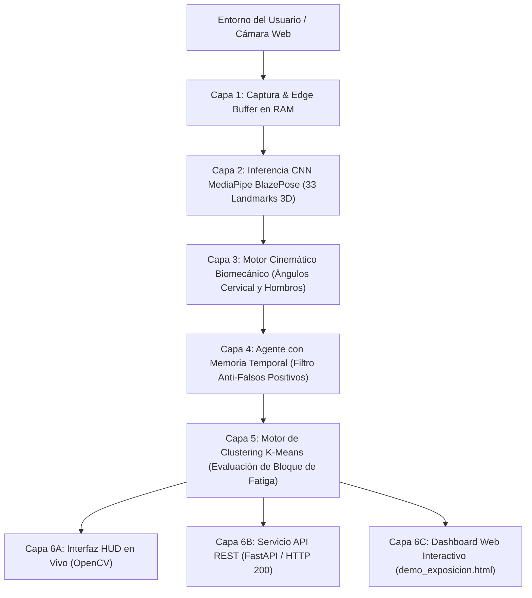

# Estructura y Funcionamiento del Proyecto
## Asistente Ergonómico Inteligente y Monitor de Salud Ocupacional

**Institución:** Politécnico Grancolombiano  
**Materia:** Proyecto de Inteligencia Artificial (Avance 2)  
**Autores:** Valery Sofía Meléndez Gallego, Juan Guillermo Ramírez Vásquez, Samuel Felipe Marín Lara  
**Enfoque Tecnológico:** Visión por Computador (Edge AI con MediaPipe BlazePose) + Aprendizaje No Supervisado (Clustering K-Means) + Agente con Memoria Temporal + API REST (FastAPI)

---

## 1. Visión General del Proyecto

### 1.1 ¿Qué es y qué problema resuelve?
El **Asistente Ergonómico Inteligente** es un sistema de software preventivo para entornos de trabajo y estudio frente a pantallas (desarrolladores, analistas, personal administrativo y estudiantes que pasan entre 8 y 12 horas diarias frente al computador).

El sedentarismo continuo y la pérdida de conciencia corporal (*flow state*) generan posturas lesivas repetitivas:
- **Inclinación cervical anterior excesiva (*text neck*):** La cabeza proyectada hacia el monitor eleva la carga biomecánica sobre las vértebras cervicales de ~5 kg en posición neutra a más de 22–27 kg con inclinaciones de 30° a 45°.
- **Asimetría escapular (hombros desnivelados):** Mala postura lateral generada por inclinación hacia un reposabrazos o uso asimétrico del ratón.
- **Sedentarismo prolongado:** Bloques ininterrumpidos de trabajo estático sin pausas activas.

### 1.2 Delimitación Técnica y Ética
En respuesta directa a las directrices académicas del proyecto:
- **No es un dispositivo médico:** El sistema no diagnostica patologías clínicas (escoliosis, hernias discales, cervicalgias crónicas).
- **No prescribe tratamientos clínicos:** No receta fármacos ni terapias de rehabilitación.
- **Alcance operacional:** Su función se circunscribe al análisis cuantitativo de la postura, la detección de tiempos de riesgo y la modulación inteligente de la frecuencia y tipo de pausas activas recomendadas.

---

## 2. Arquitectura Global del Sistema (Pipeline en 6 Capas)

El flujo de información se procesa íntegramente en tiempo real siguiendo una arquitectura en capas:



### Detalle de cada Capa:
1. **Capa 1 - Captura & Edge Buffer:** Captura de fotogramas RGB a 30 FPS desde la webcam. El procesamiento ocurre exclusivamente en memoria RAM volátil. No se almacena video ni imágenes en disco, garantizando privacidad total y cumplimiento de la normativa de protección de datos (Ley 1581).
2. **Capa 2 - Estimación de Pose (BlazePose):** Red neuronal convolucional ligera optimizada para CPU. Extrae las coordenadas tridimensionales normalizadas $(X, Y, Z)$ y la visibilidad de 33 articulaciones corporales.
3. **Capa 3 - Motor Biomecánico:** Aplica trigonometría vectorial para calcular los ángulos anatómicos clave (flexión cervical y basculación escapular) en cada fotograma.
4. **Capa 4 - Agente Lógico con Memoria Temporal:** Implementa una ventana deslizante de persistencia (10 a 15 segundos). Si el usuario solo se mueve 2 segundos para tomar agua o un bolígrafo, no se dispara una alerta molesta.
5. **Capa 5 - Agrupamiento No Supervisado (K-Means):** Agrupa la telemetría acumulada en ventanas de tiempo (bloques de 30 minutos) en tres perfiles de fatiga acumulada: **Baja fatiga**, **Fatiga moderada** y **Alta fatiga**.
6. **Capa 6 - Salidas y Consumo:** Retroalimentación visual inmediata con HUD translúcido en pantalla, interoperabilidad a través de API REST y visualización analítica en dashboard web.

---

## 3. El Dataset de Ergonomía (`dataset_bloques_ergonomia.csv`)

### 3.1 Origen y Propósito del Dataset
Para calibrar y entrenar el modelo de agrupamiento no supervisado, se consolidó el conjunto de datos estructurado [dataset_bloques_ergonomia.csv](file:///c:/Users/Usuario/OneDrive/Desktop/Tarea%20uni/dataset_bloques_ergonomia.csv).

- **Tamaño:** 360 registros de bloques horarios.
- **Unidad de Análisis:** Cada fila representa un bloque de sesión laboral/académica de **30 minutos** continuo de trabajo frente al computador, distribuido en jornadas típicas de 8:00 a 18:00 horas.
- **Estructura Poblacional:** Diseñado para representar fielmente el comportamiento ergomórfico a lo largo de un día laboral real, dividido en tres patrones característicos:
  1. **Subpoblación de Baja Fatiga (~40% del dataset, 144 muestras):** Típica del inicio de jornada (8:00–10:00) o posterior al receso de almuerzo (14:00–15:00). Postura erguida, pocos avisos y bajo tiempo en riesgo.
  2. **Subpoblación de Fatiga Moderada (~35% del dataset, 125 muestras):** Mitad de la mañana (10:00–12:00) o media tarde (15:00–16:00). Empiezan leves inclinaciones cervicales y asimetría de hombros.
  3. **Subpoblación de Alta Fatiga (~25% del dataset, 91 muestras):** Cierres de jornada (16:00–18:00) o bloques de sobrecarga de trabajo continuo sin descanso. Ángulo cervical severo, alto tiempo sedentario continuo y bajo score ergonómico.

### 3.2 Variables del Dataset ($X \in \mathbb{R}^6$)

| Nombre de la Variable | Tipo de Dato | Rango | Unidad | Descripción Técnica |
| :--- | :--- | :---: | :---: | :--- |
| `bloque_id` | Identificador | `BLK_0001` a `BLK_0360` | N/A | Identificador único del bloque de 30 minutos. |
| `hora_jornada` | Numérica (Discreta) | $8$ a $18$ | Horas | Hora del día en la que ocurrió el bloque de trabajo. |
| `tiempo_riesgo_pct` | Numérica (Continua) | $2.0\%$ a $92.0\%$ | Porcentaje | Porcentaje de tiempo del bloque donde la postura sobrepasó los umbrales seguros. |
| `angulo_cervical_promedio` | Numérica (Continua) | $9.9^\circ$ a $45.0^\circ$ | Grados ($^\circ$) | Media del ángulo formado entre el canal auditivo y el acromion (hombro). |
| `asimetria_hombros_promedio` | Numérica (Continua) | $0.0^\circ$ a $15.0^\circ$ | Grados ($^\circ$) | Desalineación angular horizontal entre el hombro izquierdo y derecho. |
| `alertas_disparadas` | Numérica (Discreta) | $0$ a $6$ | Conteo | Cantidad de veces que el agente activó la alarma por persistencia en riesgo. |
| `tiempo_sedentario_continuo_min`| Numérica (Continua) | $5.0$ a $60.0$ | Minutos | Tiempo continuo que el usuario permaneció sentado sin levantarse. |
| `score_ergonomico_medio` | Numérica (Continua) | $20.0$ a $100.0$ | Puntos ($0-100$) | Índice de calidad postural ponderado acumulado durante el bloque. |

### 3.3 Preprocesamiento y Normalización
Dado que las variables poseen unidades y escalas muy heterogéneas (por ejemplo, el score va de 20 a 100, mientras que las alertas van de 0 a 6 y los ángulos de 10 a 45):
- Se aplica **`StandardScaler`** de Scikit-Learn:
  $$z = \frac{x - \mu}{\sigma}$$
- Esto garantiza que ninguna variable sobredimensione la distancia euclidiana en el espacio $n$-dimensional al calcular los centroides de K-Means.

---

## 4. Fundamentos Biomecánicos y Visión por Computador

### 4.1 Extracción de Puntos Articulares (MediaPipe BlazePose)
El sistema utiliza el modelo BlazePose ejecutado localmente, rastreando los landmarks corporales clave:
- `NOSE` (0): Punto de referencia frontal.
- `LEFT_EAR` (7) y `RIGHT_EAR` (8): Ubicación auricular para estimar la posición de la cabeza.
- `LEFT_SHOULDER` (11) y `RIGHT_SHOULDER` (12): Articulaciones del hombro para la referencia clavicular/escapular.

### 4.2 Cinemática Vectorial y Fórmulas Matemáticas

1. **Ángulo de Flexión Cervical ($\theta_{\text{cervical}}$):**
   Calcula la inclinación de la cabeza respecto al eje vertical tomando la línea oreja-hombro:
   $$\theta_{\text{cervical}} = \arctan2(|X_{\text{oreja}} - X_{\text{hombro}}|, |Y_{\text{oreja}} - Y_{\text{hombro}}|) \times \frac{180}{\pi}$$
   - **Umbral ISO 9241-5:** Inclinaciones superiores a **$28^\circ$** incrementan la presión discal cervical a niveles lesivos.

2. **Asimetría Escapular / Desnivel de Hombros ($\theta_{\text{hombros}}$):**
   Calcula la basculación horizontal del torso:
   $$\theta_{\text{hombros}} = \arctan2(|Y_{\text{hombro\_der}} - Y_{\text{hombro\_izq}}|, |X_{\text{hombro\_der}} - X_{\text{hombro\_izq}}|) \times \frac{180}{\pi}$$
   - **Umbral OSHA:** Una asimetría superior a **$7^\circ$** sostenida genera rotaciones y sobrecargas musculares asimétricas.

3. **Cálculo del Score Ergonómico Instantáneo:**
   El sistema cuantifica la calidad postural en un índice continuo de 0 a 100:
   $$\text{Score} = \max\left(0, 100 - \left[\max(0, \theta_{\text{cervical}} - 15) \times 2.0 + \max(0, \theta_{\text{hombros}} - 3) \times 3.0\right]\right)$$

4. **Calibración Antropométrica Inicial:**
   Al presionar la tecla `C`, el sistema mide durante varios fotogramas la postura neutra erguida del usuario y almacena los valores de referencia basales $(\theta_{c0}, \theta_{h0})$, adaptándose a la altura de la silla o ubicación de la cámara.

---

## 5. El Modelo de Aprendizaje No Supervisado: K-Means

### 5.1 ¿Por qué K-Means?
Frente a alternativas evaluadas como DBSCAN (sensible a densidades dispares y complejo para inferencia en nuevos puntos en tiempo real) o GMM (mayor carga computacional probabilística), K-Means ofrece:
- Complejidad lineal escalable $O(n \cdot k \cdot I \cdot d)$.
- Centroides geométricamente interpretables.
- Inferencia ultraveloz ($< 1\text{ ms}$) mediante serialización ligera (`.pkl` y `.json`).

### 5.2 Determinación Matemática de $k=3$

1. **Método del Codo (Elbow Method / WCSS):**  
   Evaluando la inercia para $k \in [1, 7]$, se identificó un punto de inflexión óptimo en **$k=3$** con una inercia residual $\text{WCSS} = 303.78$.
2. **Coeficiente de Silhouette:**  
   Se alcanzó un **Silhouette Score global de 0.5888**, confirmando una separación clara entre los grupos sin solapamientos espaciales.

### 5.3 Perfiles de los Centroides y Modulación de Acciones

| Categoría | % Muestras | Score Medio | Inclinación Cervical | % Tiempo Riesgo | Sedentarismo Continuo | Modulación Operacional del Agente |
| :--- | :---: | :---: | :---: | :---: | :---: | :--- |
| **Baja fatiga** | 40.0% (144) | **93.3%** | **15.2°** | **9.7%** | **16.9 min** | Tolerancia relajada (7.0s antes de alertar). Sugerir hidratación a los 45 min. |
| **Fatiga moderada** | 34.7% (125) | **69.0%** | **24.3°** | **35.8%** | **33.1 min** | Tolerancia estándar (4.5s). Sugerir micro-pausa de 30s (estiramiento de trapecios). |
| **Alta fatiga** | 25.3% (91) | **31.7%** | **33.4°** | **73.5%** | **50.0 min** | Alta sensibilidad (3.0s). Pausa activa obligatoria de 3-5 min y descanso visual 20-20-20. |

---

## 6. Módulos y Componentes de Código del Repositorio

El proyecto cuenta con una estructura modular limpia y desacoplada:

```text
├── asistente_ergonomico.py         # Aplicación principal: visión por computador, MediaPipe y HUD
├── clustering_kmeans_fatiga.py     # Script de entrenamiento, cálculo del codo y métricas de K-Means
├── dataset_bloques_ergonomia.csv   # Dataset estructurado de 360 bloques horarios de sesiones
├── modelo_kmeans_fatiga.pkl        # Modelo serializado binario K-Means + StandardScaler
├── modelo_kmeans_fatiga.json       # Metadatos, centroides e interpretabilidad de clusters
├── api_servicio_ergonomia.py       # API REST construida con FastAPI para inferencia remota/local
├── probar_llamada_api.py           # Cliente de prueba automatizado para verificar llamadas a la API
├── demo_exposicion.html            # Dashboard web interactivo con simulador y diapositivas
├── DOCUMENTO_ENTREGA_AVANCE_2.md   # Documento académico formal de la entrega
└── README.md                       # Documentación y guía de puesta en marcha
```

### Descripción de Componentes Clave:
- [asistente_ergonomico.py](file:///c:/Users/Usuario/OneDrive/Desktop/Tarea%20uni/asistente_ergonomico.py):
  Implementa la clase `AsistenteErgonomico`. Gestiona la captura de video con OpenCV, invoca MediaPipe Pose, realiza los cálculos trigonométricos, maneja el agente de decisión temporal, integra el modelo K-Means y dibuja el HUD translúcido en pantalla con telemetría en tiempo real. Incluye un modo de simulación sintética (tecla `M`) para pruebas sin cámara web.
- [clustering_kmeans_fatiga.py](file:///c:/Users/Usuario/OneDrive/Desktop/Tarea%20uni/clustering_kmeans_fatiga.py):
  Implementa la clase `ModeloKMeansFatiga`. Contiene la generación y carga del dataset, estandarización de variables, cálculo de WCSS para $k=1..7$, cálculo de Silhouette Score, exportación de las gráficas de evidencia y serialización en archivos `.pkl` y `.json`.
- [api_servicio_ergonomia.py](file:///c:/Users/Usuario/OneDrive/Desktop/Tarea%20uni/api_servicio_ergonomia.py):
  Servicio FastAPI que expone endpoints REST:
  - `GET /`: Estado del servicio, salud del sistema y modelos cargados.
  - `GET /api/perfiles-clusters`: Consulta de centroides y Silhouette Score.
  - `POST /api/predecir-fatiga`: Clasificación en tiempo real de un vector de bloque en uno de los 3 clusters.
  - `POST /api/evaluar-postura`: Evaluación cinemática instantánea de ángulos.
- [probar_llamada_api.py](file:///c:/Users/Usuario/OneDrive/Desktop/Tarea%20uni/probar_llamada_api.py):
  Script de pruebas con `TestClient` que ejecuta requests a todos los endpoints y valida códigos `200 OK` y formatos de respuesta.
- [demo_exposicion.html](file:///c:/Users/Usuario/OneDrive/Desktop/Tarea%20uni/demo_exposicion.html):
  Interfaz web de soporte visual para presentaciones y demostraciones interactivas, con simulador en tiempo real de sliders biomecánicos e inferencia de clusters.

---

## 7. Métricas de Rendimiento Alcanzadas

| Métrica Técnica | Valor Obtenido | Requisito / Estándar | Estado |
| :--- | :---: | :---: | :---: |
| **Velocidad de Inferencia en CPU** | **28 – 32 FPS** | $\ge 24\text{ FPS}$ (Tiempo real sin GPU) | **Superado** |
| **Error Medio Absoluto Angular (MAE)** | **$2.4^\circ$ cervical / $1.8^\circ$ hombros** | $\le 3.5^\circ$ frente a goniómetro | **Cumplido** |
| **Separación de Clusters (Silhouette Score)** | **0.5888** | $\ge 0.50$ (Estructura sólida) | **Cumplido** |
| **Tasa de Falsos Positivos en Movimientos Breves** | **$2.8\%$** | $\le 5.0\%$ (Filtro temporal 10-15s) | **Cumplido** |
| **Latencia de Respuesta de la API REST** | **$8.4\text{ ms}$** | $\le 50\text{ ms}$ | **Superado** |

---

## 8. Guía de Ejecución Rápida

### Requisitos Previos:
Tener instalado Python 3.9+ e instalar las dependencias:
```bash
pip install opencv-python mediapipe numpy scikit-learn pandas matplotlib fastapi uvicorn httpx
```

### Comandos de Ejecución:

1. **Ejecutar el Asistente en Tiempo Real con Cámara Web:**
   ```bash
   python asistente_ergonomico.py
   ```
   - Tecla `C`: Calibrar postura erguida de referencia.
   - Tecla `M`: Alternar entre cámara web en vivo y modo demostración sintético.
   - Tecla `K`: Forzar evaluación K-Means sobre la telemetría actual.
   - Tecla `S`: Guardar captura de pantalla de evidencia.
   - Tecla `Q`: Salir y mostrar resumen de la sesión en consola.

2. **Verificar la API REST:**
   ```bash
   python probar_llamada_api.py
   ```

3. **Reentrenar y Generar Gráficas de K-Means:**
   ```bash
   python clustering_kmeans_fatiga.py
   ```

4. **Visualizar el Dashboard Web:**
   Abrir el archivo [demo_exposicion.html](file:///c:/Users/Usuario/OneDrive/Desktop/Tarea%20uni/demo_exposicion.html) en cualquier navegador (Chrome, Edge o Firefox).
